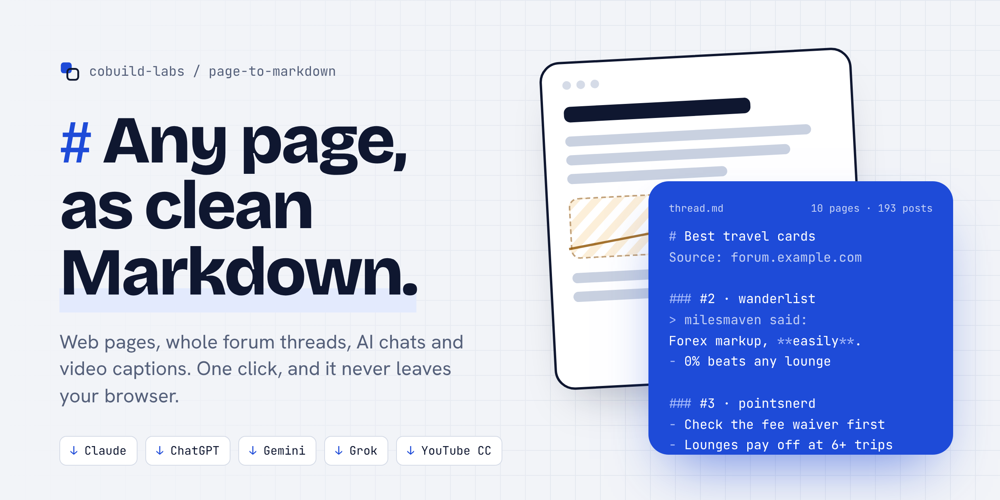
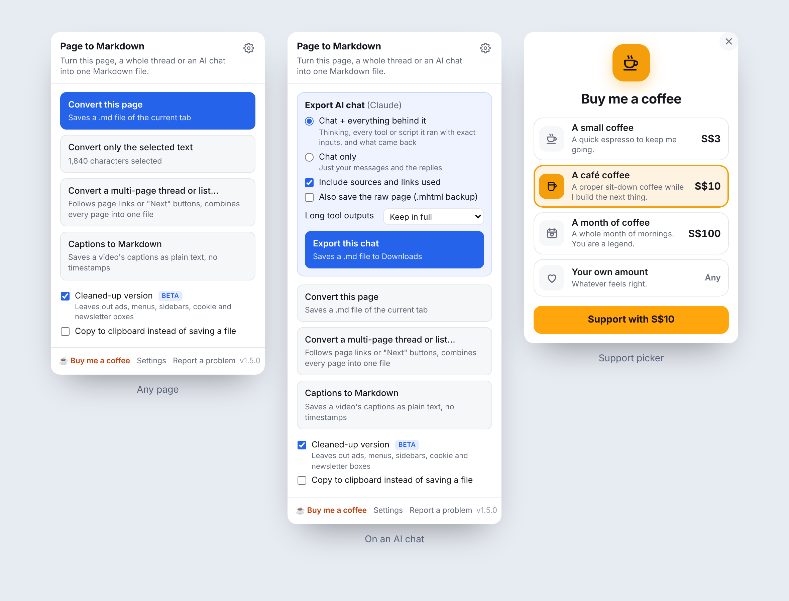
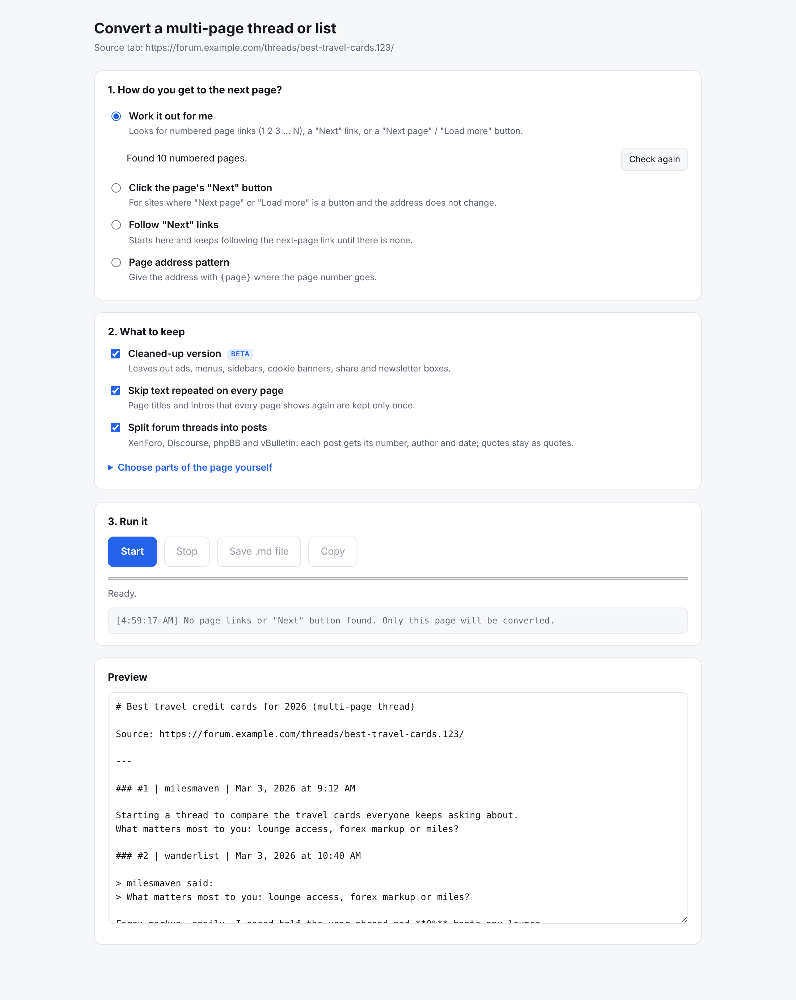
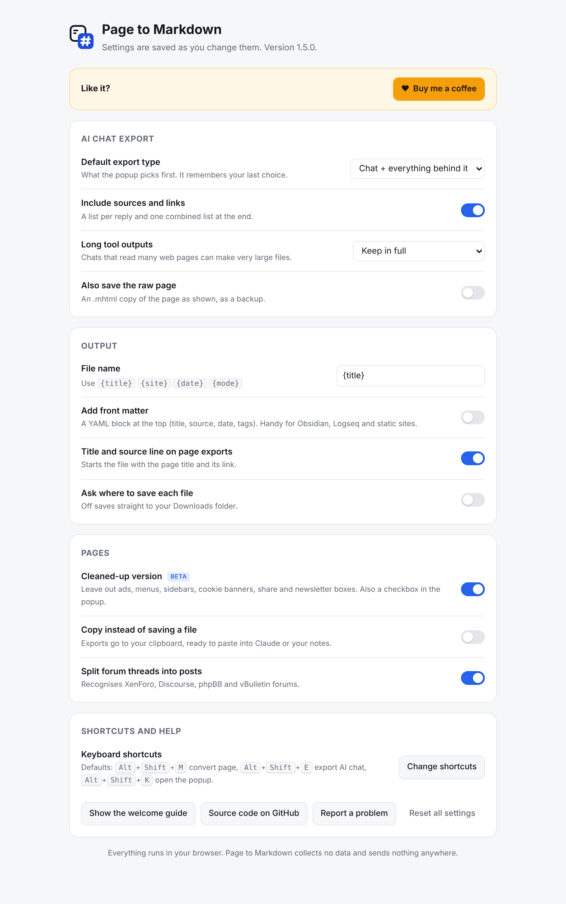

<p align="center">
  
</p>

<p align="center">
  <a href="https://github.com/cobuild-labs/page-to-markdown/releases/latest"></a>
  
  
  
</p>

<p align="center">
  <b>Turn any web page, a whole multi-page thread, an AI chat or a video's captions into one clean Markdown file.</b><br>
  Built for feeding the web to Claude, ChatGPT, Gemini, Obsidian and your notes. Runs entirely in your browser.
</p>

<p align="center">
  <a href="https://thecobuild.pages.dev/download/page-to-markdown"><b>Download</b></a> ·
  <a href="#install-in-two-minutes">Install</a> ·
  <a href="#what-it-does">Features</a> ·
  <a href="#ai-chat-export">AI chat export</a> ·
  <a href="PRIVACY.md">Privacy</a> ·
  <a href="#feedback">Feedback</a> ·
  <a href="#support">Support ☕</a> ·
  <a href="https://thecobuild.pages.dev/page-to-markdown/">Website</a>
</p>

<br>

<picture>
  <source media="(prefers-color-scheme: dark)" srcset=".github/assets/showcase-dark.png">
  
</picture>

## Why

Copy and paste from a web page gives you broken spacing, cookie banners and half a thread. "Save as" gives you a folder of HTML nobody can read. And when you hand an AI a chat export, the useful part (what it searched, which scripts it ran, what came back) is usually missing.

Page to Markdown fixes that with one click. You get a tidy `.md` file that any AI, notes app or text editor reads perfectly.

### If you work with AI

Markdown is the format AI tools read best. A clean `.md` file keeps the structure (headings, lists, tables, quotes, who said what) and drops the HTML, scripts and clutter that waste tokens and confuse the model.

- **Feed real data into your analysis.** Turn a 10-page forum thread, a long list of companies, a product comparison or a set of reviews into one file, then drop it into Claude, ChatGPT, Gemini or NotebookLM and ask your questions against the whole thing, not just page one.
- **Give the AI the full picture.** AI assistants often can't open a page that needs your login, loads with JavaScript or spreads over many pages. The extension reads it in your own browser and hands the AI exactly what you see.
- **Pass work between AIs.** Export a chat from Claude, ChatGPT, Gemini, Grok, Perplexity or DeepSeek with every search, script and result behind it, then give it to another chat (or another AI) so it picks up where the last one left off, without redoing the work or guessing how it was done.
- **Keep what the AI made.** Save the chat and every file it produced (spreadsheets, documents, images, Canvas pages, reports) in one zip, with the chat linking to each file.
- **Learn from videos faster.** Save a lecture's or tutorial's captions as clean paragraphs and ask an AI to summarise, quiz you or make notes from them.
- **Spend fewer tokens.** A cleaned-up Markdown file is a fraction of the size of the raw page, so more of the content fits in the AI's context.

### Even without AI

- **Save pages properly.** A readable, searchable `.md` file instead of a messy copy and paste, a bookmark that might break, or an HTML folder you never open again.
- **Archive whole threads and lists.** Keep a complete copy of a discussion or directory in one file, in order, with authors and dates.
- **Build your notes.** Drop articles straight into Obsidian, Logseq, Notion or any notes app, with optional front matter for title, source and date.
- **Read and share anywhere.** Markdown opens on every device and in every editor, and is easy to search, diff and keep in Git.

## What it does

| | |
|---|---|
| **📄 Any page** | Converts the current tab to Markdown: headings, lists, tables, code blocks, links and quotes all survive. Highlight some text first to convert just that part. |
| **📚 Whole threads and lists** | Follows numbered page links, "Next" links, or "Next page" / "Load more" buttons, and stitches every page into one file. It works out which kind of paging a site uses on its own. |
| **💬 Forums, post by post** | Recognises XenForo, Discourse, phpBB and vBulletin. Every post gets its number, author and date, quotes stay as quotes, and the pinned first post appears only once. |
| **🤖 AI chats** | Exports Claude, ChatGPT, Gemini, Grok, Perplexity and DeepSeek conversations in full detail (thinking, every tool call, the sources), plus about 65 other AI tools through a general chat reader. [More below](#ai-chat-export). |
| **📦 Files the AI made** <sup>Pro</sup> | Optionally saves the chat as a `.zip` with every file the AI produced (and your uploads, if you like), linked from the chat. |
| **🗃️ Whole Claude projects** <sup>Pro</sup> | One `.zip` with a project's files, its instructions and every chat in it. |
| **🎬 Captions to Markdown** | Saves a video's closed captions as readable paragraphs with no timestamps. Works with YouTube, Vimeo and most HTML5 players, including players inside iframes. With Pro, do a whole playlist or course in one go. |
| **🧹 Cleaned-up version** <sup>beta</sup> | Leaves out ads, menus, sidebars, cookie banners, share buttons and newsletter boxes. |
| **🎯 Pick on page** | For unusual layouts, hover and click the part of the page you want (or want to leave out). Your picks are remembered per site. |
| **📋 Copy instead of save** | Send the result straight to your clipboard, ready to paste into a chat. |
| **🗂️ Your file, your way** | File name patterns (`{title}`, `{site}`, `{date}`, `{mode}`), Obsidian-style YAML front matter, and an optional "where to save" dialog. |
| **🌗 Light and dark** | Every screen follows your system theme. |

## AI chat export

Open a chat on an AI site and an *Export AI chat* box appears at the top of the popup.

- **Chat + everything behind it**: your messages, the replies, the thinking, every tool or script the AI ran with its exact input, and what came back.
- **Chat only**: just the conversation.
- **Include sources**: every link or file the AI used, listed under each reply and again at the end.
- **Save the files it made**: the export becomes one `.zip`, with the chat's `.md` and a `files/` folder. [More below](#files-the-ai-made).
- **Long tool outputs**: keep them in full, or trim to 20,000 or 4,000 characters.
- **Raw backup**: also save an `.mhtml` copy of the page, in case a site changes its layout.

How much detail you get depends on the site:

| Site | What you get |
|---|---|
| **Claude** | Reads the same conversation data claude.ai loads in your tab, so behind a one-line summary like "Searched the web" you get the exact query, the full result, any errors and the citations, in order. |
| **ChatGPT** | The conversation data too: reasoning summaries, the code it ran and its output, web searches, citations as normal links, Canvas documents, and Deep Research reports. |
| **Gemini** | Every turn without scrolling, the full thinking (more than the screen shows), sources with titles, the draft you picked, and Canvas documents. Works in Gems too. |
| **Grok** | Each web search with its query and results, the thinking steps, and inline citations. |
| **Perplexity** | Each question, the searches it ran, and the answer with its [1][2] citations linked to the sources. |
| **DeepSeek** | Thinking, web searches and citations, following the branch you see if you edited a message. |
| **Any other AI app** | Copilot, Meta AI, Le Chat, Poe, NotebookLM, Kimi, Qwen and about 60 more. A general reader works out who said what from the page and opens collapsed "thinking" and "steps" panels. On a tool it doesn't know, use the *Export it as an AI chat* link in the popup. |

If a site changes and its conversation data can't be read, the export falls back to reading the page and tells you it did.

The file is labelled for machines and people alike (`[Thinking]`, `[Step 3: tool …]`, `[Result of …]`), with a short legend at the top, so another AI can pick up exactly where the last one left off.

### Files the AI made

Tick **Save the files it made** and you get one zip:

```text
Budget model - ChatGPT (full).zip
├── Budget model - ChatGPT (full).md
├── files/
│   ├── budget.xlsx
│   ├── Market report.md
│   └── chart.png
└── uploads/          (only if you tick "Include files I uploaded too")
    └── brief.pdf
```

Every file is linked from the place in the chat where it appeared, so you can click from the conversation straight to the file.

- **Claude:** files it sent you, files from its workspace in older chats, and artifacts at their final version. Published artifacts are linked.
- **ChatGPT:** files from its code runs, generated images and charts, Canvas documents and Deep Research reports.
- **Gemini:** generated images and Canvas documents (memos, code, HTML slides), with earlier versions when a Canvas changed over several turns.
- **Grok:** generated images.
- **Any other AI app:** pictures and downloadable files in the replies, skipping avatars and icons.

Code and config files (`.js`, `.py`, `.css`, `.json` and the like) are left out unless you tick **Include code files**; they are still listed by name in the chat. A file the site no longer keeps (old code-run files, for example) is marked "no longer available" instead of stopping the export.

## Install in two minutes

The extension is not on the Chrome Web Store yet, so you add it yourself. It works in Chrome, Edge, Brave, Arc and other Chromium browsers, on Mac and Windows.

1. **[Download the zip](https://thecobuild.pages.dev/download/page-to-markdown)** (`page-to-markdown-v1.13.0.zip`).
2. **Unzip it.**
   - **Mac:** double-click the zip in Downloads.
   - **Windows:** right-click the zip, choose **Extract All…**, then **Extract**.

   You get a folder called `page-to-markdown-v1.13.0`. Move it somewhere it can stay, like Documents.
3. **Open your extensions page:** type `chrome://extensions` in the address bar (Edge: `edge://extensions`, Brave: `brave://extensions`) and switch on **Developer mode** (top right in Chrome, left sidebar in Edge).
4. **Click Load unpacked** and choose the folder you unzipped: the one with `manifest.json` directly inside it.
5. **Pin it:** click the puzzle-piece icon in the toolbar, then the pin next to Page to Markdown.

**Keep the folder.** Your browser runs the extension from it, so don't delete or move it after loading.

**To update:** from 1.12 on, the extension tells you when a new version is out and walks you through it. On an older version, unzip the new version over the old folder (replace the files) and click the reload icon on the extension's card. Your settings stay.

<details>
<summary><b>If something goes wrong</b></summary>

- **"Manifest file is missing or unreadable"**: you picked the wrong folder. Choose the one with `manifest.json` directly inside, not the folder above it, and not the zip itself.
- **No "Load unpacked" button**: Developer mode is still off.
- **A note about developer-mode extensions**: some browsers show one for anything not from the store. It's safe to keep the extension on.
- **Nothing happens on a page**: reload that page once after installing, then try again.
</details>


## Shortcuts

| Action | Windows and Linux | Mac |
|---|---|---|
| Open the popup | <kbd>Alt</kbd> + <kbd>Shift</kbd> + <kbd>K</kbd> | <kbd>⌥ Option</kbd> + <kbd>⇧ Shift</kbd> + <kbd>K</kbd> |
| Convert this page | <kbd>Alt</kbd> + <kbd>Shift</kbd> + <kbd>M</kbd> | <kbd>⌥ Option</kbd> + <kbd>⇧ Shift</kbd> + <kbd>M</kbd> |
| Export the open AI chat | <kbd>Alt</kbd> + <kbd>Shift</kbd> + <kbd>E</kbd> | <kbd>⌥ Option</kbd> + <kbd>⇧ Shift</kbd> + <kbd>E</kbd> |
| Convert page or selection | Right-click → *Convert … to Markdown* | Right-click (or Control-click) → *Convert … to Markdown* |

On older Mac keyboards the Option key may be labelled **alt**; it's the same key. Change any shortcut at `chrome://extensions/shortcuts` (Edge: `edge://extensions/shortcuts`).

## A closer look

<table>
  <tr>
    <td width="50%"></td>
    <td width="50%"></td>
  </tr>
  <tr>
    <td align="center"><sub><b>Multi-page converter</b>: detects the paging, shows a live preview, saves or copies the result.</sub></td>
    <td align="center"><sub><b>Settings</b>: export defaults, file names, front matter, clean-up and shortcuts.</sub></td>
  </tr>
</table>

## Privacy

**No analytics, no tracking, and no account needed for the free features.** Pages and chats are read inside your own browser tab and saved straight to your computer. When you export an AI chat, the extension asks that AI site for your conversation and its files through your own signed-in session, the same way the site's page does, and nothing goes anywhere else. The only things stored are your settings and a local export count (used to decide when to show a one-time "Enjoying it?" card). If you sign in for Pro, the extension only checks your plan; it never sends what you export. Full details in [PRIVACY.md](PRIVACY.md).

<details>
<summary><b>Why does it ask for access to all sites?</b></summary>

So it can read whichever page you are on when you click it, including multi-page threads it opens in background tabs and video players inside iframes from other sites. Nothing runs until you click a button or use a shortcut, and nothing is ever sent anywhere.

| Permission | Used for |
|---|---|
| `activeTab`, `scripting`, `<all_urls>` | Reading the page you choose to convert |
| `tabs` | Opening pages of a multi-page thread in the background |
| `downloads` | Saving the `.md` or `.zip` file |
| `pageCapture` | The optional `.mhtml` backup of an AI chat |
| `contextMenus` | The right-click menu items |
| `storage` | Your settings |
| `clipboardWrite` | "Copy instead of save" |
</details>

## FAQ

<details>
<summary><b>A site came out messy or empty. What now?</b></summary>

Try once with **Cleaned-up version** switched off. If that's still wrong, use **Choose parts of the page yourself** in the multi-page screen to pick the content. Then please [open a "site not working" issue](https://github.com/cobuild-labs/page-to-markdown/issues/new/choose) with the public URL so it can be fixed for everyone.
</details>

<details>
<summary><b>The AI export missed something.</b></summary>

AI sites change how they work every few months. If the popup says it "used the on-screen view", the site's conversation data couldn't be read and you got what was on screen instead. Tick **Also save the raw page** as a safety net and [report it](https://github.com/cobuild-labs/page-to-markdown/issues/new/choose). Please describe what was missing rather than pasting your chat.
</details>

<details>
<summary><b>Some files in the zip say "no longer available".</b></summary>

The AI site no longer keeps them. ChatGPT, for example, can clear files from its code runs after a while, and Gemini's image server sometimes refuses downloads of your own uploads. The chat still lists each file by name, so you know what was there.
</details>

<details>
<summary><b>Does it work on Firefox or Safari?</b></summary>

Not yet. It's built on Chrome's Manifest V3 and works in any Chromium browser.
</details>

<details>
<summary><b>Is it free?</b></summary>

The everyday features are free and need no account. Pro (saving the AI's files, whole Claude projects, captions from a whole playlist or course) is US$12 a year, US$25 once as a Founding member, or part of [CoBuild Pro](https://thecobuild.pages.dev/pro/). A free CoBuild account gets 5 Pro uses a month. Owning Unpack unlocks Pro too. See [the Pro plans](https://thecobuild.pages.dev/page-to-markdown/#pro).
</details>

## Roadmap

- [ ] Chrome Web Store listing
- [ ] Firefox build

Have an idea? [Suggest a feature](https://github.com/cobuild-labs/page-to-markdown/issues/new/choose).

## Feedback

I'd love to hear how you use it, what works and what doesn't.

- 💬 **[Share feedback or an idea](https://github.com/cobuild-labs/page-to-markdown/discussions)** in Discussions: what you like, what's missing, how you use it with your AI tools.
- 🐞 **[Report a bug or a site that doesn't convert well](https://github.com/cobuild-labs/page-to-markdown/issues/new/choose)**.

## Support

The free features stay free, with no ads. It's built and maintained independently, so if it saves you time, a coffee keeps the next feature coming:

<p>
  <a href="https://buy.stripe.com/dRmbJ2bJNfPWfwheUX00001"></a>
  <a href="https://buy.stripe.com/28EbJ2bJNeLS1FrfZ100002"></a>
  <a href="https://buy.stripe.com/3cI3cwg03fPWbg128b00004"></a>
</p>

## License

© 2026 CoBuild. All rights reserved. Page to Markdown is free to download and use, but its code may not be copied, changed or shared. See [LICENSE](LICENSE).

<br>

<p align="center">
  <a href="https://thecobuild.pages.dev"></a><br>
  <sub>Made by <a href="https://thecobuild.pages.dev">CoBuild</a>. Co-building the future.</sub>
</p>
