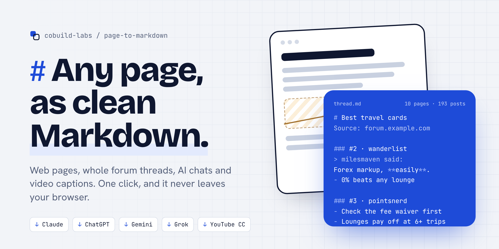
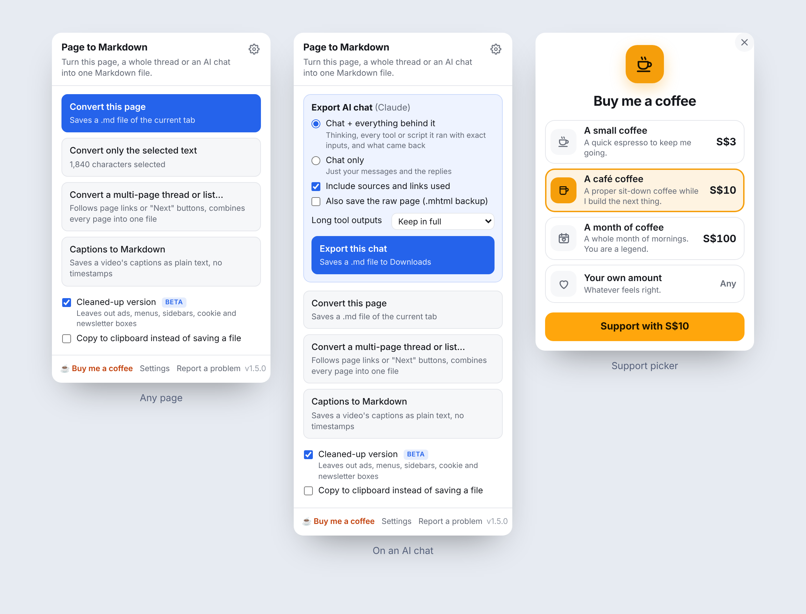
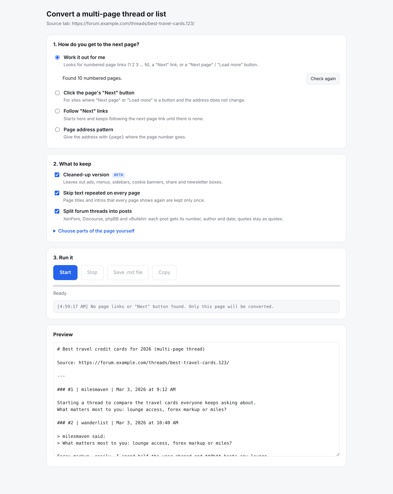
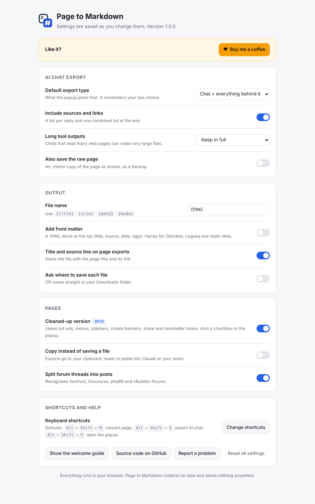

<p align="center">
  
</p>

<p align="center">
  <a href="https://github.com/cobuild-labs/page-to-markdown/releases/latest"></a>
  
  
  
  <a href="LICENSE"></a>
</p>

<p align="center">
  <b>Turn any web page, a whole multi-page thread, an AI chat or a video's captions into one clean Markdown file.</b><br>
  Built for feeding the web to Claude, ChatGPT, Gemini, Obsidian and your notes. Runs entirely in your browser.
</p>

<p align="center">
  <a href="https://github.com/cobuild-labs/page-to-markdown/releases/latest"><b>Download</b></a> ·
  <a href="#install-in-a-minute">Install</a> ·
  <a href="#what-it-does">Features</a> ·
  <a href="#ai-chat-export">AI chat export</a> ·
  <a href="PRIVACY.md">Privacy</a> ·
  <a href="#feedback">Feedback</a> ·
  <a href="#support">Support ☕</a> ·
  <a href="https://cobuild-labs.github.io/page-to-markdown/">Website</a>
</p>

<br>

<picture>
  <source media="(prefers-color-scheme: dark)" srcset=".github/assets/showcase-dark.png">
  
</picture>

## Why

Copy and paste from a web page gives you broken spacing, cookie banners and half a thread. "Save as" gives you a folder of HTML nobody can read. And when you hand an AI a chat export, the useful part (what it searched, which scripts it ran, what came back) is usually missing.

Page to Markdown fixes that with one click. You get a tidy `.md` file that any AI, notes app or text editor reads perfectly.

### If you work with AI

Markdown is the format AI tools read best. A clean `.md` file keeps the structure (headings, lists, tables, quotes, who said what) and drops the HTML, scripts and clutter that waste tokens and confuse the model.

- **Feed real data into your analysis.** Turn a 10-page forum thread, a long list of companies, a product comparison or a set of reviews into one file, then drop it into Claude, ChatGPT, Gemini or NotebookLM and ask your questions against the whole thing, not just page one.
- **Give the AI the full picture.** AI assistants often can't open a page that needs your login, loads with JavaScript or spreads over many pages. The extension reads it in your own browser and hands the AI exactly what you see.
- **Pass work between AIs.** Export a Claude chat with every search, script and result behind it, then give it to another chat (or another AI) so it picks up where the last one left off, without redoing the work or guessing how it was done.
- **Learn from videos faster.** Save a lecture's or tutorial's captions as clean paragraphs and ask an AI to summarise, quiz you or make notes from them.
- **Spend fewer tokens.** A cleaned-up Markdown file is a fraction of the size of the raw page, so more of the content fits in the AI's context.

### Even without AI

- **Save pages properly.** A readable, searchable `.md` file instead of a messy copy and paste, a bookmark that might break, or an HTML folder you never open again.
- **Archive whole threads and lists.** Keep a complete copy of a discussion or directory in one file, in order, with authors and dates.
- **Build your notes.** Drop articles straight into Obsidian, Logseq, Notion or any notes app, with optional front matter for title, source and date.
- **Read and share anywhere.** Markdown opens on every device and in every editor, and is easy to search, diff and keep in Git.

## What it does

| | |
|---|---|
| **📄 Any page** | Converts the current tab to Markdown: headings, lists, tables, code blocks, links and quotes all survive. Highlight some text first to convert just that part. |
| **📚 Whole threads and lists** | Follows numbered page links, "Next" links, or "Next page" / "Load more" buttons, and stitches every page into one file. It works out which kind of paging a site uses on its own. |
| **💬 Forums, post by post** | Recognises XenForo, Discourse, phpBB and vBulletin. Every post gets its number, author and date, quotes stay as quotes, and the pinned first post appears only once. |
| **🤖 AI chats** | Exports Claude, ChatGPT, Gemini and Grok conversations, optionally with the thinking, every tool call and the sources. [More below](#ai-chat-export). |
| **🎬 Captions to Markdown** | Saves a video's closed captions as readable paragraphs with no timestamps. Works with YouTube, Vimeo and most HTML5 players, including players inside iframes. |
| **🧹 Cleaned-up version** <sup>beta</sup> | Leaves out ads, menus, sidebars, cookie banners, share buttons and newsletter boxes. |
| **🎯 Pick on page** | For unusual layouts, hover and click the part of the page you want (or want to leave out). Your picks are remembered per site. |
| **📋 Copy instead of save** | Send the result straight to your clipboard, ready to paste into a chat. |
| **🗂️ Your file, your way** | File name patterns (`{title}`, `{site}`, `{date}`, `{mode}`), Obsidian-style YAML front matter, and an optional "where to save" dialog. |
| **🌗 Light and dark** | Every screen follows your system theme. |

## AI chat export

Open a chat on **Claude, ChatGPT, Gemini or Grok** and an *Export AI chat* box appears at the top of the popup.

- **Chat + everything behind it**: your messages, the replies, the thinking, every tool or script the AI ran with its exact input, and what came back.
- **Chat only**: just the conversation.
- **Include sources**: every link or file the AI used, listed under each reply and again at the end.
- **Long tool outputs**: keep them in full, or trim to 20,000 or 4,000 characters.
- **Raw backup**: also save an `.mhtml` copy of the page, in case a site changes its layout.

How much detail you get depends on the site:

| Site | What you get |
|---|---|
| **Claude** | The most complete export. It reads the same conversation data claude.ai loads in your tab, so behind a one-line summary like "Searched the web" you get the exact query, the full result, any errors and the citations, in order. |
| **ChatGPT, Gemini, Grok** | The extension opens their collapsed "Thinking", "Worked for…" and Sources panels and exports what they show. |

The file is labelled for machines and people alike (`[Thinking]`, `[Step 3: tool …]`, `[Result of …]`), with a short legend at the top, so another AI can pick up exactly where the last one left off.

## Install in a minute

The extension is not on the Chrome Web Store yet, so you load it yourself. It takes about a minute and works in Chrome, Edge, Brave, Arc and other Chromium browsers.

1. Download **`page-to-markdown-v1.5.0.zip`** from the [latest release](https://github.com/cobuild-labs/page-to-markdown/releases/latest) and unzip it.
2. Open `chrome://extensions` and switch on **Developer mode** (top right).
3. Click **Load unpacked** and choose the unzipped folder.
4. Pin it: click the puzzle-piece icon in the toolbar, then the pin next to Page to Markdown.

To update later, unzip the new version over the old folder and click the reload icon on the extension's card.

<details>
<summary><b>Install from source</b></summary>

```bash
git clone https://github.com/cobuild-labs/page-to-markdown.git
```

Then use **Load unpacked** on the `extension` folder.
</details>

## Shortcuts

| Action | Shortcut |
|---|---|
| Open the popup | <kbd>Alt</kbd> + <kbd>Shift</kbd> + <kbd>K</kbd> |
| Convert this page | <kbd>Alt</kbd> + <kbd>Shift</kbd> + <kbd>M</kbd> |
| Export the open AI chat | <kbd>Alt</kbd> + <kbd>Shift</kbd> + <kbd>E</kbd> |
| Convert page or selection | Right-click → *Convert … to Markdown* |

Change them any time at `chrome://extensions/shortcuts`.

## A closer look

<table>
  <tr>
    <td width="50%"></td>
    <td width="50%"></td>
  </tr>
  <tr>
    <td align="center"><sub><b>Multi-page converter</b>: detects the paging, shows a live preview, saves or copies the result.</sub></td>
    <td align="center"><sub><b>Settings</b>: export defaults, file names, front matter, clean-up and shortcuts.</sub></td>
  </tr>
</table>

## Privacy

**No account, no analytics, no tracking, no servers.** Pages and chats are read inside your own browser tab and saved straight to your computer. The only things stored are your settings and a local export count (used to decide when to show a one-time "Enjoying it?" card). Full details in [PRIVACY.md](PRIVACY.md).

<details>
<summary><b>Why does it ask for access to all sites?</b></summary>

So it can read whichever page you are on when you click it, including multi-page threads it opens in background tabs and video players inside iframes from other sites. Nothing runs until you click a button or use a shortcut, and nothing is ever sent anywhere.

| Permission | Used for |
|---|---|
| `activeTab`, `scripting`, `<all_urls>` | Reading the page you choose to convert |
| `tabs` | Opening pages of a multi-page thread in the background |
| `downloads` | Saving the `.md` file |
| `pageCapture` | The optional `.mhtml` backup of an AI chat |
| `contextMenus` | The right-click menu items |
| `storage` | Your settings |
| `clipboardWrite` | "Copy instead of save" |
</details>

## FAQ

<details>
<summary><b>A site came out messy or empty. What now?</b></summary>

Try once with **Cleaned-up version** switched off. If that's still wrong, use **Choose parts of the page yourself** in the multi-page screen to pick the content. Then please [open a "site not working" issue](https://github.com/cobuild-labs/page-to-markdown/issues/new/choose) with the public URL so it can be fixed for everyone.
</details>

<details>
<summary><b>The AI export missed something.</b></summary>

AI sites change their page layouts every few months. Tick **Also save the raw page** as a safety net and [report it](https://github.com/cobuild-labs/page-to-markdown/issues/new/choose). Please describe what was missing rather than pasting your chat.
</details>

<details>
<summary><b>Does it work on Firefox or Safari?</b></summary>

Not yet. It's built on Chrome's Manifest V3 and works in any Chromium browser.
</details>

<details>
<summary><b>Is it free?</b></summary>

Yes, and open source under the GPL-3.0 license. If it saves you time, you can <a href="https://buy.stripe.com/28EbJ2bJNeLS1FrfZ100002">buy me a coffee</a> ☕.
</details>

## Roadmap

- [ ] Chrome Web Store listing
- [ ] Firefox build

Have an idea? [Suggest a feature](https://github.com/cobuild-labs/page-to-markdown/issues/new/choose).

## Feedback

I'd love to hear how you use it, what works and what doesn't.

- 💬 **[Share feedback or an idea](https://github.com/cobuild-labs/page-to-markdown/discussions)** in Discussions: what you like, what's missing, how you use it with your AI tools.
- 🐞 **[Report a bug or a site that doesn't convert well](https://github.com/cobuild-labs/page-to-markdown/issues/new/choose)**.
- ⭐ **Star the repo** if it's useful. It helps other people find it.

## Contributing

Bug reports, site fixes and pull requests are very welcome. See [CONTRIBUTING.md](CONTRIBUTING.md) for how the code is laid out and how to test a change. There's no build step: it's plain JavaScript, HTML and CSS.

## Support

Page to Markdown is free, open source and has no ads, and it stays that way. It's built and maintained independently, so if it saves you time, a coffee keeps the next feature coming:

<p>
  <a href="https://buy.stripe.com/dRmbJ2bJNfPWfwheUX00001"></a>
  <a href="https://buy.stripe.com/28EbJ2bJNeLS1FrfZ100002"></a>
  <a href="https://buy.stripe.com/3cI3cwg03fPWbg128b00004"></a>
</p>

Or simply **star the repo** ⭐. It genuinely helps other people find it.

## License

Page to Markdown is free software, © 2026 CoBuild, released under the [GNU General Public License v3.0](LICENSE).

In short: you can use it, change it and share it, including your own modified versions. If you share a modified version, it must also be open source under GPL-3.0, with its source code available, and keep this copyright notice.

<br>

<p align="center">
  <a href="https://thecobuild.pages.dev"></a><br>
  <sub>Made by <a href="https://thecobuild.pages.dev">CoBuild</a>. Co-building the future.</sub>
</p>
